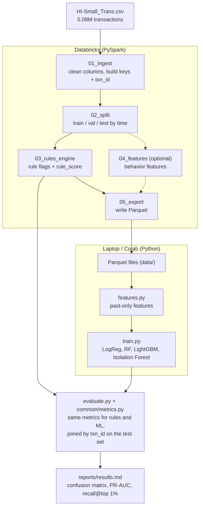

# Money Laundering Classification in Bank Transactions Using Machine Learning

EAS 510 Project 2: rule-based engine (PySpark on Databricks) vs ML models
(logistic regression, random forest, LightGBM) on the IBM AML HI-Small dataset.

**Research question:** if investigators can only review the top 1% of transactions,
can our best ML model catch at least 2x more money laundering than a rule-based system?

## Architecture

Two detectors, one fair test. Both score the **same test transactions**, and both are
judged against the same ground truth column, `is_laundering`.

### What each step does

| Step | File | Plain-English job |
|---|---|---|
| 1 | `databricks/01_ingest.py` | Read the raw CSV, give columns clean names, build `from_key` / `to_key` (bank + account) and a unique `txn_id`, save the Delta table `workspace.aml.transactions`. |
| 2 | `databricks/02_split.py` | Add a `split` column (train ~60% / val ~20% / test ~20%) by **time**, once, so rules and ML are tested on identical rows. |
| 3 | `databricks/03_rules_engine.py` | Flag each transaction with simple rules (large amount, round amount, currency change, cash/Bitcoin, high velocity) and sum them into `rule_score`. This is the baseline. |
| 4 | `databricks/04_features.py` | Optional. Spark version of the behavior features, only if pandas is too slow. |
| 5 | `databricks/05_export.py` | Write the results as Parquet so the ML side can load them. |
| 6 | `ml/features.py`, `train.py` | Build features from past data only, train and tune the models. |
| 7 | `ml/evaluate.py`, `common/metrics.py` | Score rules and ML with the same metrics on the same test rows. |

### Design decisions

- **Time-based split, saved once.** Predicting the future from the past is the real use
  case. A random split would leak future behavior into training.
- **One source of truth for the split.** `02_split` creates it; rules and ML both read it.
- **Train-only statistics.** Thresholds (such as the 99th-percentile amount) are learned
  on train days only.
- **Join on `txn_id`.** Rule scores and ML scores are matched row by row for the final
  comparison.
- **Parquet as the hand-off format.** A compact, typed, columnar file that Spark writes
  and pandas reads quickly. Much smaller than CSV.
- **Metrics:** PR-AUC (main), recall@top 1%, precision@top 100, precision / recall / F1,
  ROC-AUC, confusion matrix. Never accuracy, since only 1 in 1,000 transactions is
  laundering.

### Data

- Source: [IBM Transactions for Anti-Money Laundering (Kaggle)](https://www.kaggle.com/datasets/ealtman2019/ibm-transactions-for-anti-money-laundering-aml), file `HI-Small_Trans.csv`.
- Download locally: `uv run python ml/download_data.py` (saves to `data/raw/`, git-ignored).
- Upload to Databricks: `/Volumes/workspace/default/raw_data/HI-Small_Trans.csv`.

## Results: rule-engine baseline (Databricks)

- **Dashboard:** [Rule engine baseline dashboard](https://dbc-d3eb941a-e954.cloud.databricks.com/dashboardsv3/01f1e3e27b141734bc19c5b4e279a62b/published?o=7474655710448676)
  (requires access to the Databricks workspace; if you cannot open it, use the PDF below).
- **PDF copy of the dashboard:** [reports/Aml Dashboard 2026-11-19 01_28_49 2026-11-19 06_52.pdf](reports/Aml%20Dashboard%202026-11-19%2001_28_49%202026-11-19%2006_52.pdf)
- **Notebook:** [databricks/03_rules_engine.py](databricks/03_rules_engine.py)

Validation split, top 1% review budget (10,149 of 1,014,951 transactions):

| Metric | Value |
|---|---|
| Laundering cases in split | 1,080 |
| Caught in top 1% | 14 |
| Recall@top 1% | 1.30% |
| Precision@top 1% | 0.14% |
| Precision@top 100 | 0.00% |

What the dashboard shows: about two thirds of laundering cases score 0 (no rule fires),
and the highest laundering rates appear at scores 5 and 6 on small counts. The rules are
a weak baseline (about 1.3x better than random), which is the bar the ML models must
beat by 2x.
